# Auditoría de reservas y add-ons — 19 de octubre de 2026

Este informe registra los hallazgos del estado inicial del repositorio. El seguimiento de correcciones en `develop` aparece al final.

## Alcance y estado de verificación

- Núcleo: commit inicial `8c60ec2`, rama `develop`, plugin declarado `1.8.1`.
- Producción declarada por el propietario: OV Booking WhatsApp `1.0.3`. Se revisó el ZIP local `ov-booking-whatsapp- 1.0.3.zip`; sus 11 archivos coinciden por SHA-256 con la carpeta extraída local.
- En pruebas: Clientes + Historial `1.1.0`. Ventas `1.0.0` no se usa, según confirmó el propietario; se revisó solo su acoplamiento con los eventos del núcleo.
- Revisión estática del núcleo, las entradas AJAX, disponibilidad, persistencia, administración, hooks, gestor de módulos, WhatsApp 1.0.3 y acoplamiento con Clientes + Historial. No se dispuso de una instalación WordPress, base de datos, PHP CLI, WP-CLI ni acceso al webhook de producción. Por tanto, el comportamiento en ejecución y la configuración real del sitio siguen pendientes de prueba.
- Los add-ons están fuera de este repositorio Git y no se modificaron.

## Cómo funciona una reserva

```mermaid
flowchart LR
    Cliente[Formulario público o panel] --> AJAX[ov_create_booking]
    AJAX --> Validar[Contexto, datos, términos y límites]
    Validar --> Lock[GET_LOCK por formulario]
    Lock --> Cupo[Revalidar disponibilidad]
    Cupo --> DB[(Reserva pending)]
    DB --> Evento[ov_booking_reservation_created]
    Evento --> Cola[(WhatsApp outbox)]
    Cola --> Cron[WP-Cron y Cloud API]
    Cron --> Webhook[Webhook firmado de Meta]
    Webhook --> Estado[Transición pending a confirmed o cancelled]
    Estado --> Update[ov_booking_reservation_updated]
    Update --> Otros[Add-ons de pruebas]
```

1. El shortcode `[ov_booking id="…"]` carga el formulario. Los endpoints públicos ofrecen servicios, profesionales, campos, configuración y disponibilidad (`includes/class-ov-booking-system.php:121-127`, `includes/api/class-ov-ajax-handler.php:58-85`). La reserva administrativa usa la misma acción con nonce administrativo.
2. `create_booking()` valida nonce y capacidad para la ruta administrativa, pertenencia y actividad de formulario/servicio/profesional, datos y teléfono, campos requeridos, términos configurados, límites por IP/teléfono y clave de idempotencia (`includes/api/class-ov-ajax-handler.php:459-600`).
3. Toma un bloqueo MySQL por formulario, vuelve a comprobar idempotencia y cupo, elige profesional si se pidió “cualquiera”, calcula duración y guarda una reserva `pending` (`includes/api/class-ov-ajax-handler.php:602-720`). La disponibilidad considera horarios ordinarios y especiales, festivos, duración, cupo y reservas no canceladas (`includes/helpers/class-ov-availability.php`; `includes/models/class-ov-reservation.php:153-180`).
4. Tras liberar el bloqueo, emite `ov_booking_reservation_created` (`includes/api/class-ov-ajax-handler.php:743-750`). En la ruta pública no se vincula ni modifica una ficha de paciente: `patient_id` queda vacío; la ruta administrativa puede buscar o crear ficha (`includes/api/class-ov-ajax-handler.php:702-715`).
5. WhatsApp 1.0.3 agrega una fila única por reserva a su outbox, y WP-Cron envía la plantilla con un token aleatorio. Un webhook firmado y correlacionado con el mensaje, teléfono y token cambia `pending` a `confirmed` o `cancelled` de forma condicional. Cancelar libera el cupo sin borrar la reserva (`class-ov-whatsapp-outbox.php:21-64`, `class-ov-whatsapp-webhook.php:62-99,148-237`, `includes/models/class-ov-reservation.php:319-341`).
6. El panel puede editar estado y datos de la reserva; el modelo emite eventos de actualización y eliminación consumidos por add-ons (`includes/api/class-ov-ajax-handler.php:903-1137`, `includes/models/class-ov-reservation.php:265-354`). Clientes + Historial solo genera historial automático de reservas completadas que tengan `patient_id`.

## Versiones y empaquetado

| Componente | Versión de código | Otras marcas | Interpretación |
| --- | --- | --- | --- |
| Núcleo | Cabecera y `OV_BOOKING_VERSION`: `1.8.1` | `README.md`, `INSTALACION.md` y `CAMPOS-DINAMICOS.md`: `1.8.0` | Títulos documentales desactualizados. Los hechos históricos de 1.8.0 deben conservarse. |
| Base de datos núcleo | `OV_Updater::CURRENT_VERSION`: `1.8.0` | `ov_booking_db_version`: `1.8.0` | Correcto si 1.8.1 no alteró el esquema. No debe aumentarse solo por igualar el número del plugin. |
| Opción `ov_booking_version` | El actualizador la escribe como `1.8.0` | La cabecera dice `1.8.1` | Mezcla versión del plugin y versión de esquema; queda obsoleta en instalaciones existentes y nuevas. |
| WhatsApp producción | `1.0.3`, mínimo núcleo `1.8.1` | Esquema propio `1.0.0` | Separación de versión del add-on y del esquema es válida. |
| Clientes + Historial | `1.1.0`, mínimo núcleo `1.8.0` | En pruebas | La integración con reservas públicas requiere un diseño explícito de identidad. |

El ZIP local de WhatsApp 1.0.3 contiene la carpeta raíz `ov-booking-whatsapp- 1.0.3/`; los ZIP 1.0.0–1.0.2 contienen `ov-booking-whatsapp/`. WordPress identifica el archivo principal también por su ruta relativa, por lo que este cambio de carpeta puede producir una instalación paralela o complicar la sustitución del add-on anterior. Antes de otro despliegue, el ZIP debe usar el slug estable y se debe comprobar la ruta real instalada.

## Hallazgos priorizados

### P1 — Riesgo de pérdida de datos o fallo operativo

1. **Borrado masivo con alcance mayor que el listado.** La pantalla filtra por formulario, estado, profesional y búsqueda; la acción envía solo formulario y estado. Sin formulario, el listado muestra formularios activos, pero el borrado consulta toda la tabla. La confirmación afirma que borra el listado actual. Una persona con `manage_ov_booking` puede eliminar reservas ocultas por los filtros (`admin/views/reservations-list.php:15-43,756-759`, `admin/class-ov-admin.php:122`, `includes/api/class-ov-ajax-handler.php:1101-1136`). Se necesita una sola definición de filtros compartida por listado y borrado, un conteo previo verificable y confirmación del alcance exacto.
2. **Reactivar una reserva cancelada puede sobreocupar un horario.** La disponibilidad excluye `cancelled`. El cambio de estado del panel no toma bloqueo ni revalida cupo; la edición completa solo lo hace cuando cambia fecha u hora. Una reserva cancelada cuyo cupo fue ocupado puede volver a `pending`, `confirmed` o `completed` en el mismo horario (`includes/models/class-ov-reservation.php:153-180`, `includes/api/class-ov-ajax-handler.php:903-953,1031-1054`). Las transiciones que vuelven a ocupar cupo necesitan bloqueo y comprobación dentro del bloqueo.
3. **“Desactivar” WhatsApp desde Módulos no lo desactiva.** `OV_Module_Manager::is_enabled()` devuelve `true` para todo módulo sin licencia, antes de consultar el estado guardado; WhatsApp se registra con `requires_license=false`. La pantalla ofrece “Desactivar”, pero el nuevo estado no afecta a `is_enabled()` (`includes/class-ov-module-manager.php:126-157,254-267`, `admin/views/modules.php:39-75`; WhatsApp `class-ov-whatsapp-module.php:14-23`). El interruptor propio de ajustes de WhatsApp sí controla el envío. Se debe hacer coherente el estado del gestor con la operación real sin apagar instalaciones existentes por defecto.
4. **Paquete WhatsApp 1.0.3 con carpeta distinta.** El ZIP cambia el slug de directorio respecto a 1.0.2. Verificar el plugin activo y la ruta en producción antes de instalar otro ZIP; reconstruir próximos paquetes con `ov-booking-whatsapp/` como raíz estable.

### P2 — Integridad, escalabilidad y compatibilidad

5. **Pérdida silenciosa de la notificación inicial.** El núcleo confirma la reserva aunque falle un listener del evento de creación; WhatsApp devuelve `false` si no puede insertar la fila en outbox. No queda una obligación durable en el núcleo para reintentar ese evento (`includes/api/class-ov-ajax-handler.php:743-752`; WhatsApp `class-ov-whatsapp-outbox.php:21-64`). Hay que registrar/mostrar fallos de encolado sin exponer datos y verificar conciliación entre reservas `pending` y outbox.
6. **Clientes + Historial no incorpora reservas públicas nuevas.** La corrección de seguridad 1.8.1 deja `patient_id` vacío para reservas públicas. El add-on solo sincroniza perfil e historial con ese ID y el backfill selecciona únicamente filas con `patient_id IS NOT NULL` (`includes/api/class-ov-ajax-handler.php:702-715`; Clientes `class-ov-customers-module.php:207-243`, `class-ov-customers-data.php:538-567`). Es consistente con no unir fichas sin verificar identidad, pero el flujo de pacientes en pruebas no cubre todavía esas reservas. Diseñar vinculación administrativa o identidad verificada antes de producción.
7. **Disponibilidad mensual pública costosa.** Cada petición recalcula hasta 31 días; con “cualquier profesional” recorre profesionales y, por horario, hace consultas de conteo. No hay caché ni límite de uso propio del endpoint (`includes/api/class-ov-ajax-handler.php:325-415`; `includes/helpers/class-ov-availability.php:471-603`). Su costo crece aproximadamente con días × profesionales × franjas y puede cargar la base de datos. Medir consultas y latencia; limitar rango temporal y reducir consultas repetidas antes de aumentar tráfico.
8. **Dashboard y calendario administrativo incompletos y con consultas repetidas.** Ambos cargan como máximo 1.000 reservas por formulario y luego consultan servicios y profesionales por reserva (`admin/views/dashboard.php:22-30,92-99`, `admin/views/reservations-list.php:50-56,112-116`). Totales y eventos pueden omitir registros; el costo de memoria y las consultas N+1 crecen con los formularios. Agregar consultas agregadas y carga por rango de fechas.
9. **Opción de versión mezclada.** `OV_Updater::maybe_update()` guarda `1.8.0` en `ov_booking_version` cuando migra el esquema, aunque `OV_BOOKING_VERSION` es `1.8.1`; la activación intenta después `add_option()`, que no reemplaza ese valor (`includes/class-ov-updater.php:21-28`, `includes/class-ov-activator.php:13-18,300-305`). Conservar `ov_booking_db_version` para migraciones y sincronizar por separado `ov_booking_version` con la cabecera.
10. **Un error de almacenamiento del webhook puede perder una respuesta.** WhatsApp devuelve HTTP 200 tras procesar el payload aun cuando `insert_inbox()` falla; el mismo resultado `0` se usa para un duplicado y para un error de base de datos (`class-ov-whatsapp-webhook.php:62-99,195-199,265-277`). Si el fallo es transitorio, la confirmación o cancelación no queda registrada para reintento. Separar duplicados de fallos de almacenamiento y devolver un error reintentable cuando no se pueda persistir el mensaje.

### P3 — Casos límite

11. **Términos marcados como obligatorios sin contenido.** El editor permite `required=true` con URL y texto vacíos. La interfaz no muestra casilla y el servidor no exige aceptación en ese caso (`admin/views/form-editor.php:48-52,608-613`, `public/assets/js/ov-booking.js:870-890`, `includes/api/class-ov-ajax-handler.php:520-525`). Impedir guardar esa combinación o definir explícitamente que no hay términos que aceptar.
12. **Evento de borrado sin fila borrada.** `OV_Reservation::delete()` emite `ov_booking_reservation_deleted` para cualquier resultado distinto de `false`, incluido `0` filas afectadas (`includes/models/class-ov-reservation.php:347-354`). Emitirlo solo cuando el resultado sea `1`.

## Controles constatados

- El endpoint público de creación valida contexto y disponibilidad en servidor y serializa la inserción por formulario mediante `GET_LOCK()`; la clave `request_key` es única en la tabla.
- El núcleo no enlaza fichas de pacientes desde reservas públicas solo por conocer teléfono, correo o RUT.
- Los endpoints administrativos de modificación de reservas comprueban capacidad y nonce.
- El CSV usa lotes de 500 y protege celdas que podrían interpretarse como fórmulas.
- WhatsApp 1.0.3 separa el envío mediante outbox, exige firma HMAC en POST, correlaciona `wamid`/contexto/teléfono y hace la transición desde `pending` de forma condicional. Su ejecución depende de WP-Cron y de que las credenciales y la plantilla real estén correctamente configuradas.

Estas constataciones no prueban ausencia de vulnerabilidades en el sitio desplegado.

## Pruebas necesarias en `develop` antes de fusionar a `main`

1. Levantar WordPress con las versiones mínimas declaradas (WordPress 5.8 y PHP 7.4) y una combinación actual soportada, más MySQL/MariaDB compatible con `GET_LOCK()`; ejecutar lint PHP y comprobar activación/migración desde una copia anonimizada.
2. Probar reservas públicas y administrativas, reintentos con el mismo `request_id`, último cupo con dos solicitudes simultáneas, “cualquier profesional”, duración de varios días, festivos, zonas horarias y cambios de horario.
3. Probar `cancelled → pending/confirmed` cuando otra reserva ya tomó el cupo; confirmar que se rechaza sin afectar el estado anterior.
4. Probar borrado masivo con búsqueda, profesional, formulario inactivo y varios estados. Confirmar antes y después los IDs exactos afectados y los eventos enviados a add-ons.
5. Instalar WhatsApp 1.0.3 con el slug correcto en staging. Simular envío exitoso, fallo de encolado, timeout incierto, reintento, confirmación, anulación, mensaje duplicado, botón vencido y edición de una cita ya notificada. Comprobar cron y outbox.
6. Verificar que Módulos no ofrezca desactivar WhatsApp y que el ajuste propio de WhatsApp 1.0.3 siga controlando el envío.
7. Probar Clientes + Historial con reservas públicas sin `patient_id`, reservas administrativas vinculadas y backfill. No activar la vinculación automática basada únicamente en datos aportados por un visitante.
8. Medir consultas/latencia de disponibilidad mensual y exactitud de dashboard con más de 1.000 reservas por formulario.

**Estado de entrega:** las correcciones indicadas en el seguimiento están en `develop`; falta comprobarlas en WordPress staging. No fusionar a `main` ni desplegarlas hasta completar las pruebas pertinentes.

## Seguimiento de versiones en `develop`

Se alinearon los títulos de `README.md`, `INSTALACION.md` y `CAMPOS-DINAMICOS.md`, el metadato del archivo POT y la opción `ov_booking_version` con la versión pública `1.8.1`. La opción se sincroniza al cargar el plugin, también en instalaciones existentes. `ov_booking_db_version` y `OV_Updater::CURRENT_VERSION` permanecen en `1.8.0` porque este cambio no modifica el esquema. El hallazgo 9 queda corregido en código, pendiente de comprobación en WordPress.

## Seguimiento de riesgos prioritarios en `develop`

- Hallazgo 1: el listado y el borrado comparten filtros SQL. El borrado muestra cantidad y alcance, verifica que la selección no cambió y elimina únicamente esos ID en lotes. Pendiente de prueba en WordPress staging.
- Hallazgo 2: ambas rutas administrativas comprueban la disponibilidad dentro del bloqueo por formulario al reactivar una reserva cancelada. Pendiente de prueba concurrente en WordPress staging.
- Hallazgo 3: los módulos sin licencia se muestran como instalados y ya no ofrecen una desactivación ineficaz; la petición directa también se rechaza. El ajuste propio de WhatsApp 1.0.3 sigue controlando el envío. La integración de ambos controles queda para el trabajo del add-on.
- Se añadió `.gitignore` para excluir `dist/` y archivos locales. El hallazgo 12 también queda corregido en código: el evento de borrado solo se emite cuando se eliminó una fila.
